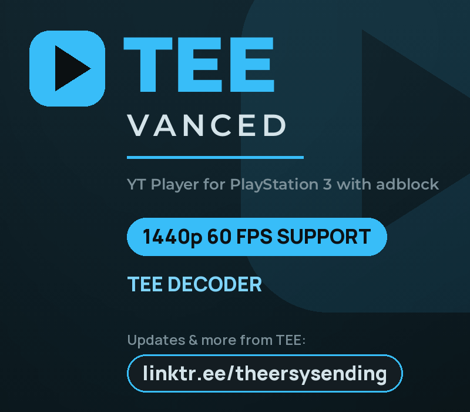
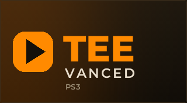

# TEE Vanced PS3

<p align="center">
  
</p>

A YouTube client for the PlayStation 3, built from source and run on real
hardware. A fork of **[mohasi's Yo! Player](https://github.com/mohasi/ps3-dev)**
(Apache-2.0) — see [NOTICE](NOTICE); the application and its libraries are his
work. The H.264 decoder it plays most videos with, and the VP9 decoder that plays 1440p, are TEE's own (below).

**Status: v3.0.1.** Every version here has been installed and used on a real
console before being called done. See [CHANGELOG.md](CHANGELOG.md).

---

## What this fork adds

**1440p at 60 fps, with sound.** YouTube's 1440p comes as VP9, which no part of
the PS3 decodes. The TEE VP9 decoder - TEE's own, on all six SPEs - plays it at 60
frames a second, scaled to 1080p by the RSX, and the TEE Opus building block
plays its Opus sound on the PPU. Pick 1440p in START > Quality; Auto stays on
1080p60 H.264. In the busiest moments a 1440p60 video drops to YouTube's 1080p60
VP9 stream for a few seconds - on its own, at the next key frame - and comes back
after them, so the picture keeps its 60 frames a second; 1440p30 very likely plays
through without that.

**A list view.** DOWN on Home - and every search and every channel page - lists
the whole feed from top to bottom: each video's picture, its title, the best
quality the PS3 plays of it ("1440p60", "1080p30"), and its channel with the
channel's picture. On the right, on the video's own picture: its description,
its quality and what else it has (subtitles, audio tracks, a live stream's
rewind), and Channel and Subscribe buttons. UP off the first video or O goes back
to the cards.

**Downloads.** R3 downloads a video as 1440p60 VP9 or 1080p60 H.264 into the
app's own Downloads page, which plays it from the disk, or as an MP4 into the
XMB's Video column. The rail shows how far it is, a note says when it is in or
failed, and one that did not finish is offered again at the next start.

**A left icon rail.** Search, For you, Trending, Live, Subscriptions, Continue
watching, Playlists, Watch Later, History, Downloads, Login and Settings, all on screen as
icons instead of behind shoulder buttons you have to remember. LEFT or O opens it, X picks,
O or RIGHT close it again; a held UP or DOWN walks through it. The icons come from the icon font already compiled into the upstream
library — nothing extra is shipped.

**Your YouTube account, optionally.** Login, at the foot of the rail, shows a
code; type it at google.com/device on your phone and the app brings your
subscriptions, Watch Later, history, playlists and recommendations - on the
Account page and in the rail's own entries - and Subscribe buttons and Square
change your account. It signs in the way YouTube's own TV app
does - the password stays on Google's page - and keeps the sign-in as plain text
in `account.txt`, so keep the console's FTP to yourself. Playback never needs
the account.

**Live, and a region.** A page of streams that are on air now - Popular,
Gaming, Sports, Podcasts, News and Music - and a choice of 33 countries for
Trending, Live and the other lists. YouTube's own Live page lists the same
world-wide mix for every country, so in Germany, Austria and Switzerland Popular
is a German live search instead.

**Subscriptions with their pictures.** Every channel you follow, as its picture
and name; channel pictures are on the cards and in the lists too, wherever
YouTube sends them.

**A settings screen.** Upstream has none: the options exist but the only way to
reach them is editing `settings.txt` over FTP. Autoplay and all seven
SponsorBlock categories are now switchable on the console, each showing its
state in colour so the screen can be read from a sofa.

**Three-way segment skipping.** Every SponsorBlock category is *Skip* (jump
automatically), *Skip by choice* (a button appears during the segment, the way
YouTube's own does) or *Keep*. That makes "skip the sponsor but let me decide
about the intro" something you can actually say.

**The PS button, on pads that do not have one.** A DualShock 4 or DualSense
pairs with a PS3 but its PS button never reaches the console, so there is no way
out of a running app. SELECT on the home screen and L3 during playback press it,
using libpad's public LDD virtual-controller API — no CFW plugin, no syscall.
This is believed to be the first PS3 *game*-context use of that API; every other
known user is a VSH plugin.

**Watch progress and Continue watching.** The resume position was always stored
and never shown. It is now a line along each thumbnail, and a category of its own.

**History, and unsubscribing from the list.** A browsable list of what you have
watched, and Triangle removes a channel where you are standing instead of making
you open it first.

**Pages, a search field with history, autoplay, chapter skipping.** Results are
paged rather than endlessly scrolled; the app keeps its own search history
because the PS3 keyboard keeps none.

**Subtitles in more scripts.** Czech, Polish, Hungarian, Romanian, Turkish,
Greek, Cyrillic and the rest of Latin show in subtitles as they do in titles.

**The original audio, and Square for the others.** YouTube serves more and more
videos with AI auto-dubbed audio tracks in other languages, and the player used
to take whichever track came last, so a video could start in a machine voice in
a language nobody asked for. It now plays the original - in 1440p too, since
v3.0.1. When a video has several tracks, the player says so as it starts, and
Square opens the list of them: pick one, and it plays on from where you are.

**Its own H.264 decoder: 1080p60 at 60 fps.** The TEE Decoder runs on the
PS3's SPEs and plays YouTube's 1080p60 at a full 60 frames a second, where
Sony's `cellVdec` manages about 35 at 1080p - live streams included. Everything
it cannot decode - Shorts, 480p - stays on `cellVdec`. A 60 fps video on the
PS3's 59.94 Hz output shows one picture per vblank, with the sound 0.1% slower
to match. START opens Options with the quality (Auto, or down to 144p for a slow
connection), the chapters and autoplay.

**Rewind a live stream.** Where the streamer left YouTube's rewind on, left/right
and L2/R2 go back through the last 12 hours of a live stream and R1 returns to
live; its quality can be switched like a video's.

**Its own look.** A dark ground with an ice-blue accent (since V3.0.0; v1.0 and
v2.0.0 were orange, "Ember"), the Manrope typeface, and a focus that can be seen
from the sofa. A new version shows what it brings once, at its first start.

**The BD Remote Control.** The PS3's own remote works the app: Enter, Play and
Pause are X, Return and Stop are O, the arrows and scan keys move and seek
(confirmed on a real remote by the user who asked for it, GitHub issue #6).

**A note when a newer version is out.** At every start the app asks its GitHub
page; `update-check=off` in `settings.txt` leaves GitHub alone.

**Your own playlists.** Local lists that nobody else can change - and, signed
in, your YouTube playlists above them. L3 files the selected video into a local
list; the sidebar opens them.

Not shipped yet: search filters (date, duration, HD), and YouTube's automatically
translated subtitles - YouTube refuses them to a client that is not signed in.

---

## Building

You need mohasi's tree and the Cell SDK. This repository holds only the files
this fork changes — vendoring 300 MB of someone else's project would be worse
for everyone.

The Cell SDK is Windows software, so the compiler runs on a Windows machine with
the SDK at `C:\usr\local\cell` and an ssh server; everything else runs on the
machine you work on, macOS or Linux. **On a Mac, follow
[docs/BUILD-MACOS.md](docs/BUILD-MACOS.md)**: it sets up that Windows VM step by
step. There is no SDK manager or macOS port of the SDK to install.

```sh
cp build.env.example build.env      # which Windows VM builds, and with which ssh key
./tools/setup-build-vm.sh           # check the VM end to end; gives a fresh one its source tree
./build.sh                          # build on the VM, check the result, package it
```

The package lands in `pkg/out/`, named after `APP_VERSION` in
`apps/yo-player/include/app-paths.h`.

`build.sh` runs these steps, and each one also works on its own:

```sh
./tools/fetch-upstream.sh           # clone mohasi's tree into ps3-dev/, at the commit this fork is built on
./tools/sync-work.sh --local        # drop this fork's apps/ and libs/ over it
python3 genbuild.py                 # generate build-ps3.bat from the .vcxproj files
./tools/sync-work.sh                # mirror sources onto the build machine
ssh <vm> "cd /d C:\ps3-dev && build-ps3.bat"
./build-pkg-fromsource.sh TEE-Vanced-PS3-v3.0.1 "TEE Vanced PS3 V3.0.1"
```

Upstream is pinned (`UPSTREAM_REV` in `tools/build-env.sh`). mohasi's tree has
moved on since this fork was written, and laying these files over a newer
checkout would mix two versions of his libraries, so a plain
`git clone https://github.com/mohasi/ps3-dev` is no longer the starting point.

`genbuild.py` exists because upstream builds with MSBuild and the SN Systems
toolset, which needs Visual Studio; it reads the project files and emits direct
`ppu-lv2-gcc` calls instead, so the Cell SDK alone is enough.

`build-pkg-fromsource.sh` builds `PARAM.SFO` from `apps/yo-player/PARAM.SFO.xml`
(`pkg/make-param-sfo.py`), signs the ELF with `make_fself_npdrm` and packages it
with `make_package_npdrm`, both from the SDK. The artwork in `branding/` is
regenerated with `tools/make-branding.py` (Pillow).

**One package for every console (PS3HEN, CFW and DEX).** A `make_fself_npdrm`
EBOOT is fake-signed: CFW and DEX run it, PS3HEN does not. Since V3.0.0 the
packages are signed as a real NPDRM SELF instead (a free license, the app's
content id), which all three run - one package, no separate HEN build. On the
Windows machine with the tools, in Git Bash:

```sh
SCETOOL_DIR=<folder of scetool.exe> PKG_CUSTOM=<path to pkg_custom.exe> \
PPU_READELF=<cell sdk>/host-win32/ppu/bin/ppu-lv2-readelf.exe \
  tools/package-universal.sh <path to yo-player.ppu.elf> <new output folder>
```

It stages `PARAM.SFO`, the artwork and `package.conf`, signs the EBOOT with
scetool, packages it with pkg_custom, checks that the signed EBOOT decrypts to
the ELF's loaded segments and prints the package's SHA-256. scetool needs its
keys in its own `data/` folder; they are not part of this repository and never
go into it - the script only passes the folder on. On CFW/DEX the app keeps its
data in `/dev_hdd0/tee-vanced` (an older data folder is copied over once).

**Verify what you built.** The build script stops on the first compile error and
wipes its object directory first — an earlier version did neither, linked a
stale object file and reported success, and shipped a package that silently did
not contain the change. `build.sh` now checks this itself: it fetches the ELF to
`pkg/out/` and refuses to package it unless it contains both the version string
and that run's build stamp. By hand, on the build machine:

```sh
ppu-lv2-strings yo-player.ppu.elf | grep "V3.0.1"
```

---

## Installing

<p align="center">
  
</p>

Install the `.pkg` from the console's package manager; it appears on the XMB as
the tile above, with its own background (`branding/PIC1.PNG`). It writes its data to a
directory it picks at runtime — `/dev_hdd0/yo-player` cannot be created on every
console, so it falls back through a list and logs which one it chose to
`/dev_hdd0/tmp/TEE_Vanced/dbg.txt`. Your subscriptions, history and settings
live there and survive uninstalling the app.

A VPN on the console makes YouTube answer `LOGIN_REQUIRED`. Turn it off.

### Nothing loads: no channel names, no thumbnails

If the subscriptions list shows raw `UC...` ids and grey boxes instead of names
and pictures, the app reached none of its servers — the tiles come from your own
`subscriptions.txt`, only the names and images need the network.

**Power the console fully off and on again.** Not an XMB restart — a real power
cycle. This has fixed it for someone whose console had got into that state
overnight and stayed there across two different builds. Worth trying before
anything else.

If it survives a power cycle, look at `/dev_hdd0/tmp/TEE_Vanced/dbg.txt`: it
names the reason. A wrong date on the console no longer stops it (since V3.0.0):
while the console's clock is plausible the certificates are checked against it,
and otherwise against a server's time - the console's clock is never changed.

---

## Licence

Apache-2.0, the same as upstream — see [LICENSE](LICENSE) and [NOTICE](NOTICE).
The TEE Decoder in `libs/simple-lib-av/src/tee_decoder/` is under the GNU LGPL,
version 2.1 or later (see `libs/simple-lib-av/tee_decoder.LICENSE`): anyone may
use it, in free or closed software, commercially too; changes to the decoder
itself stay open. The TEE VP9 decoder (`libs/simple-lib-av/src/tee_vp9/`) and the
TEE Opus building block (`libs/simple-lib-av/tee_opus/`) are TEE's own work and
have no licence of their own yet; the code they contain from libvpx and libopus is
under those projects' licences, reproduced in [NOTICE](NOTICE). The TEE name, logo
and the artwork in `branding/` are not part of any of these licences.

Contact: github@teebug.de · More from TEE: [linktr.ee/theersysending](https://linktr.ee/theersysending)
